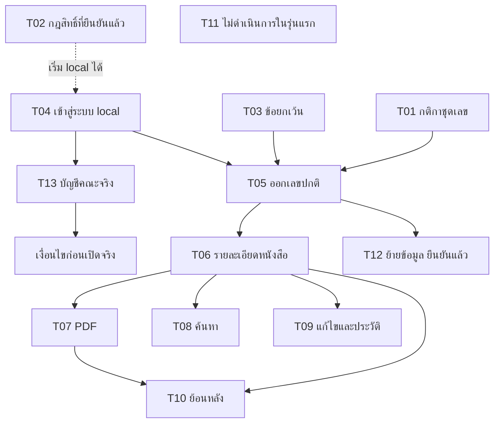

# ภาพรวม Tickets — ระบบออกเลขหนังสือราชการ

[สเปกในโปรเจกต์](../specs/correspondence-numbering.md) · [GitHub สเปก #1](https://github.com/tomhon444/genbook/issues/1)

ตรวจสถานะ GitHub ทั้งชุดเมื่อ **11 พฤศจิกายน 2026 (Asia/Bangkok)**; อัปเดต T02 (#3), T04 (#5), เริ่ม T03 (#4) และเพิ่ม T13 (#14) เมื่อ **12 พฤศจิกายน 2026** ไฟล์เหล่านี้เป็นสำเนาสำหรับวางแผนและติดตามในโปรเจกต์ **ไม่ซิงก์อัตโนมัติ** GitHub ยังเป็น issue tracker หลัก

## ความคืบหน้า

แนวทางบัญชี/ฐานข้อมูลล่าสุด: **CENTRAL ใช้ตรวจ login โดยตรง ไม่ต้อง dump แยก; GenBookno_DB ย้ายเข้าฐานใหม่และเลิกใช้ในงานประจำหลัง cutover** ยังคงตรวจ mapping และข้อมูลรอบสุดท้าย ดู [ADR 0003](../adr/0003-live-central-and-genbook-cutover.md)

T12 ล่าสุด 23 พฤศจิกายน 2569: AC4 ผ่านในฐานซ้อมใหม่จาก snapshot `d5f97eb2…` ที่รับรองเดิม history 170,257/เก็บแยก 1,874 ตรวจ HTTP สิทธิ์ 9 กรณี หน้าอ่านจริง และออกเลขพร้อมกัน/ส่งซ้ำต่อเหนือ floor ปี 2569 ผ่าน พร้อมคืน gate/ปิดสิทธิ์/ลบฐาน/ปิดพอร์ตครบ เกณฑ์เป็น 5/6 (AC1/3/4/5/6) เหลือ AC2 และ cutover; ใช้ตัวตนและ grants จำลอง ไม่รับรองสิทธิ์จริง ดู [ผลตรวจล่าสุด](../specs/t12-http-rehearsal.md) และ [ผลรับรอง mapping รอบก่อน](../specs/t12-confirmed-mapping-rehearsal.md)

ขั้น AC2 เตรียม [ชุดตรวจรับพร้อมหลักฐานปัจจุบัน](../specs/t12-ac2-review.md) แล้ว: ชื่อ 154 ชุด/44 หน่วยงาน/4 ประเภท และสิทธิ์เดิม 1,844 แถวยัง pending ผู้ใช้รับรองแนวทางแสดงเวลาเดิมโดยไม่ยืนยัน timezone จริงแล้ว Inventory ไฟล์ผูก snapshot ปัจจุบัน และตัวอย่าง PDF 3 ไฟล์ตรวจ hash/parse ผ่าน ไม่แทนการตรวจไฟล์ทั้งหมดหรืออนุมัติ production T12 คง 5/6

24 พฤศจิกายน 2569: [เติมชื่อจากระบบเก่า](../specs/t12-reference-names.md) ได้ 153/154 ชุด และชื่อประเภท 4/4; ผูกประเภทกับชุดได้ 130/154 แยกปัญหาอักขระควบคุม/parent reference ไว้แล้ว ส่วนชื่อหน่วยงาน 44 รหัสยังต้องมีช่องทางเข้ารหัสถึง CENTRAL เพราะการเชื่อม TLS ได้ `HANDSHAKE_NO_SSL_SUPPORT` ไม่มี plaintext fallback หรือเปิดสิทธิ์จริง

บันทึกก่อนหน้า T12 รอบ mapping/history จาก snapshot `78629b14…`: คิวจริงครบ 171,506 รายการ (เก็บแยก 6/เรื่องว่าง 1,845/รอ mapping 169,655/พร้อม 0) และหน้าอ่านรายละเอียดผู้รับ/ปลายทาง/ผู้ลงนาม/actor/เวลาเดิมพร้อมทดสอบด้วยข้อมูลจำลองแล้ว ขณะนั้นยังไม่ promote ประวัติจริงหรือเชื่อม CENTRAL เกณฑ์คง 3/6 ดู [หลักฐาน](../specs/local-legacy-mapping-history.md)

16 พฤศจิกายน 2026: ได้รับแหล่งฐานบัญชี/หนังสือจริงและสิทธิ์อ่านอย่างเดียวแล้ว แต่ต้นทางไม่รองรับ TLS และ automatic approval review ปฏิเสธการเชื่อมไม่เข้ารหัส ผู้ใช้เลือกช่องทางเข้ารหัส จึงยังไม่มี remote query รอบต่อมาผู้ใช้สั่งทำ **T12 แบบ offline** จากไฟล์สำรองเดิม: เก็บ raw 383,338 แถว/กันเลข 171,506 source IDs ในฐาน local ถาวรสำเร็จ ตรวจ dry-run/replay ทุกฟิลด์และ restart ผ่าน QA แล้ว ยังไม่เปิดประวัติจริงในเว็บ/ออกเลขจริง เกณฑ์ T02/T12/T13 คงเดิม ดู [ผลตรวจ remote](../specs/remote-readonly-discovery.md) และ [ฐานถาวร local](../specs/local-legacy-persistent.md)

| ตัวชี้วัด | จำนวน |
|---|---:|
| เสร็จและตรวจรับแล้ว | 9/12 (75.0%) — ตัด T11 ออก 1 งาน |
| พร้อมเริ่ม | 1 |
| กำลังทำ / รอตรวจ QA | 2 |
| รองานก่อนหน้า | 0 |
| ไม่ดำเนินการ | 1 (T11) |

ทั้งหมด 13 งาน: อยู่ในขอบเขตรุ่นแรก 12 งาน และไม่ดำเนินการ 1 งาน (T11 ตามคำยืนยัน T03 วันที่ 12 พฤศจิกายน 2026) เปอร์เซ็นต์นับงานเสร็จจาก 12 งาน ไม่ใช่ปริมาณแรงงาน T12 ยืนยันให้ย้ายข้อมูลแล้ว และ T13 เป็นเงื่อนไขบัญชีคณะก่อนเปิดจริง T11 ปิด GitHub แบบ not planned ไม่รวมเป็นงานเสร็จ

T01: เสร็จ 6/6 และ QA ผ่านเมื่อ 12 พฤศจิกายน 2026 คงชุดเลข/ปี/prefixเดิม พักชุดปีว่าง ออกทันทีตามสิทธิ์ ตรวจเวลาขณะจัดสรร ทุกวัน07:00:00–22:30:59 การเงิน/พัสดุได้ตลอดเวลา ไม่ใช้วันหยุด ผู้ดูแลระบบจัดการข้อมูลอ้างอิง และยืนยันย้ายประวัติ/เดินเลขต่อหลังตรวจยอด รายละเอียดเปิดจริงเป็นT12 ดู [หลักฐานระบบเดิม](../specs/legacy-numbering-analysis.md)

## ลำดับและสถานะรายงาน

24 พฤศจิกายน 2569: [ตรวจหลักฐานชื่อ/ประเภท 25 ชุด](../specs/t12-reference-investigation.md) แล้ว พบ TAB ต่อท้าย 1 ชุด/ประวัติ 127 รายการ และ parent หาย 21 รหัสกระทบประเภท 24 ชุด/ประวัติ 331 รายการ ผู้ใช้รับรองชื่อแสดงผลที่ตัด TAB เฉพาะชุด 00069 แล้ว บันทึก receipt แยก ไม่แก้ prefix/สถานะ/ฐานข้อมูล ประเภท 24 ชุดยัง pending T12 คง 5/6

24 พฤศจิกายน 2569: เตรียม [รายการตรวจรับ AC2 ทีละกลุ่ม](../specs/t12-decision-review.md) จากชุดชื่อปัจจุบันแล้ว ข้ออ้างอิง 202 รายการ/มีข้อยกเว้น 69 และสิทธิ์เดิม 1,844 แถวแบ่งเป็น 9 กลุ่มไม่ซ้ำแถว ทุกคำตัดสินยัง pending; T12 คง 5/6 รอผู้รับรอง/หลักฐานจริง

แนวทางยืนยัน 12 พฤศจิกายน 2026: ยึดระบบเดิมและเปลี่ยน UI เป็นหลัก ตรวจวิธีล็อกอิน/ขั้นตอน/สิทธิ์เดิมก่อน ไม่เพิ่ม SSO หรือเปลี่ยนกติกาเอง คงคำยืนยัน T01/T02 และแก้ช่องโหว่/ความเสี่ยงเลขซ้ำโดยรักษาการใช้งานเดิม รายละเอียดใน [สเปก](../specs/correspondence-numbering.md) และ [T02](./02-identity-permissions.md)

ผู้ใช้ยืนยันเพิ่มเติมให้ทำ UI/ล็อกอินด้วยบัญชีจำลองใน localhost ต่อได้ T04 รุ่น local เสร็จ 6/6 และ QA ผ่านจากกฎ T02 ที่รับรองแล้ว โดย T02 คง 4/5 และ AC1 ติดตามต่อใน T13 ห้ามเปิดให้บุคลากรใช้จริงก่อนผ่าน T13

หมายเลข T01–T13 เป็นลำดับในแผน ส่วน #2–#14 เป็นหมายเลข GitHub ต้องรอเฉพาะงานในคอลัมน์ “ต้องทำก่อน” ไม่จำเป็นต้องรอทุกแถวก่อนหน้า

| Ticket | งาน | ความยาก | สถานะ | ต้องทำก่อน | เกณฑ์ผ่าน | GitHub |
|---|---|---:|---|---|---:|---|
| T01 | [Done — สรุปกติกาชุดเลขและการเริ่มใช้ระบบ](./Done-01-numbering-rules.md) | 5/10 | เสร็จ — QA ผ่าน | — | 6/6 | [#2](https://github.com/tomhon444/genbook/issues/2) |
| T02 | [สรุปการเข้าสู่ระบบและตารางสิทธิ์](./02-identity-permissions.md) | 6/10 | กำลังทำ — localhost บัญชีจำลองผ่าน รอหลักฐานบัญชีคณะ | — | 4/5 | [#3](https://github.com/tomhon444/genbook/issues/3) |
| T03 | [Done — สรุปข้อยกเว้นของหนังสือ](./Done-03-document-exceptions.md) | 7/10 | เสร็จ — QA ผ่านด้านกติกา | — | 6/6 | [#4](https://github.com/tomhon444/genbook/issues/4) |
| T04 | [เข้าสู่ระบบและเปิดพื้นที่ส่วนตัว](./Done-04-sign-in.md) | 7/10 | เสร็จ — local บัญชีจำลอง; QA ผ่าน | กฎ T02 ยืนยันแล้ว; AC1 รอเฉพาะก่อนเปิดจริง | 6/6 | [#5](https://github.com/tomhon444/genbook/issues/5) |
| T05 | [Done — ขอเลขปกติและเปิดรายการที่ออกสำเร็จ](./Done-05-normal-issuance.md) | 9/10 | เสร็จ — local; QA ผ่าน | [T01](./Done-01-numbering-rules.md), [T03](./Done-03-document-exceptions.md), [T04](./Done-04-sign-in.md) | 7/7 | [#6](https://github.com/tomhon444/genbook/issues/6) |
| T06 | [Done — บันทึกรายละเอียดหนังสือครบถ้วน](./Done-06-document-details.md) | 6/10 | เสร็จ — local; QA ผ่าน | [T05](./Done-05-normal-issuance.md) | 6/6 | [#7](https://github.com/tomhon444/genbook/issues/7) |
| T07 | [Done — แนบและดาวน์โหลด PDF](./Done-07-pdf-attachments.md) | 8/10 | เสร็จ — local; QA ผ่าน | [T06](./Done-06-document-details.md) | 6/6 | [#8](https://github.com/tomhon444/genbook/issues/8) |
| T08 | [Done — ค้นหาหนังสือตามสิทธิ์](./Done-08-search.md) | 6/10 | เสร็จ — local; QA ผ่าน | [T06](./Done-06-document-details.md) | 6/6 | [#9](https://github.com/tomhon444/genbook/issues/9) |
| T09 | [Done — แก้ไขหนังสือและตรวจประวัติ](./Done-09-amendments-audit.md) | 7/10 | เสร็จ — local; QA ผ่าน | [T06](./Done-06-document-details.md) | 6/6 | [#10](https://github.com/tomhon444/genbook/issues/10) |
| T10 | [Done — ขอเลขย้อนหลัง](./Done-10-backdated-issuance.md) | 9/10 | เสร็จ — local; QA ผ่าน | [T06](./Done-06-document-details.md), [T07](./Done-07-pdf-attachments.md) | 7/7 | [#11](https://github.com/tomhon444/genbook/issues/11) |
| T11 | [ยกเลิกหนังสือตามสิทธิ์ (มีเงื่อนไข)](./11-cancellation.md) | 7/10 | ไม่ดำเนินการ — ไม่รวมรุ่นแรก | — | 1/5 (คัดกรองขอบเขต) | [#12](https://github.com/tomhon444/genbook/issues/12) CLOSED — not planned |
| T12 | [นำข้อมูลเดิมเข้าและตรวจความต่อเนื่อง](./12-legacy-migration.md) | 9/10 | กำลังทำ — AC4 ข้อมูลจริง/HTTP/หน้าอ่าน/เลขต่อผ่าน; รอ AC2/cutover | [T05](./Done-05-normal-issuance.md) | 5/6 | [#13](https://github.com/tomhon444/genbook/issues/13) |
| T13 | [เชื่อมบัญชีคณะและตรวจรับก่อนเปิดใช้งานจริง](./13-faculty-identity-release-gate.md) | 7/10 | พร้อมเริ่ม — เงื่อนไขก่อนเปิดจริง | [T04](./Done-04-sign-in.md) รุ่น local | 0/6 | [#14](https://github.com/tomhon444/genbook/issues/14) |

## ลำดับการทำงาน

1. เริ่ม **T01, T02, T03** ได้พร้อมกัน เพื่อปิดกติกากับเจ้าของระบบ
2. เริ่ม **T04 รุ่น local ด้วยบัญชีจำลอง** ได้จากกฎ T02 ที่รับรองแล้ว ไม่ต้องรอ AC1 บัญชีคณะหรือ T01/T03; หลักฐานบัญชีจริงติดตาม **T13** ก่อนเปิดใช้งาน
3. เมื่อ T01, T03, T04 เสร็จ เริ่ม **T05**
4. เมื่อ T05 เสร็จ เริ่ม **T06** และ **T12** (ผู้ใช้ยืนยันให้ย้ายข้อมูลแล้ว)
5. เมื่อ T06 เสร็จ เริ่ม **T07, T08, T09, T10** ตามเงื่อนไขแต่ละงาน งานเหล่านี้ไม่บล็อกกันโดยอัตโนมัติ แต่ต้องแบ่งเจ้าของไฟล์เพื่อหลีกเลี่ยงการแก้ทับกัน
6. **T10 พร้อมเริ่มหลัง T07 local ผ่าน QA แล้ว** ตามกฎ PDF ของย้อนหลังไม่ลับที่ T03 รับรอง; **T11 ไม่ดำเนินการในรุ่นแรก** ไม่รวมเป็นงานพัฒนาเสร็จ
7. หลัง T04 รุ่น local พร้อม จึงตรวจ **T13** การเชื่อมบัญชีคณะจริงและป้องกัน test bypass ก่อนเปิดใช้งาน พร้อมเงื่อนไขเปิดระบบ/ย้ายข้อมูลของ ticket อื่นที่เกี่ยวข้อง ไม่ใช่อนุมัติ deploy

## การอ่านคะแนนความยาก

คะแนนเป็นการประเมินเบื้องต้นจากความซับซ้อน ความเสี่ยง และสิ่งที่ยังไม่ทราบ ไม่ใช่จำนวนวันหรือเปอร์เซ็นต์ความคืบหน้า แต่ละไฟล์มีเหตุผลคะแนนประกอบ

- 1–3: ขอบเขตเล็ก กติกาชัด ความเสี่ยงต่ำ
- 4–6: หลายส่วนหรือมีข้อสรุปที่ต้องประสาน
- 7–8: ซับซ้อนด้านสิทธิ์ integration หรือความถูกต้องของข้อมูล
- 9–10: แกนข้อมูลสำคัญ การแข่งขันของคำขอ การย้ายข้อมูล หรือผลกระทบสูง

## วิธีอัปเดตความคืบหน้า

1. ก่อนเริ่ม อ่าน ticket และตรวจ blocker/เงื่อนไขเพิ่มเติม ตั้งผู้รับผิดชอบและเปลี่ยนสถานะเป็น “กำลังทำ” ทั้งไฟล์ ticket และตารางนี้
2. ติ๊กเกณฑ์เมื่อมีหลักฐานผ่านจริง บันทึกวันที่ ผลทดสอบ และลิงก์ commit/PR หรือข้อสรุปที่ผู้ใช้ยืนยัน แล้วอัปเดตจำนวนเกณฑ์ผ่านในตาราง
3. เมื่อส่งตรวจ ใช้ “รอตรวจ QA”; ใช้ “เสร็จ” หลังเกณฑ์ครบและ QA ผ่าน งานกติกาต้องมีข้อสรุปจากเจ้าของระบบก่อนนับว่าเสร็จ
4. อัปเดตทั้งไฟล์ ticket ตาราง/ยอดรวมหน้านี้ และ GitHub ให้สอดคล้องกัน พร้อมวันที่ตรวจล่าสุดและช่อง “เสร็จแล้ว” ปิด GitHub Issue เมื่อผ่านเกณฑ์จริง; การปิดเพราะไม่ดำเนินการไม่ใช่งานเสร็จ
5. เมื่อ blocker เสร็จ ตรวจเงื่อนไขอีกครั้งแล้วเลื่อนงานถัดไปเป็น “พร้อมเริ่ม” หากแก้ dependency ให้แก้ทั้งไฟล์ แผนภาพ และ native blocker บน GitHub
6. ตรวจเหตุผลปิดงาน ความคืบหน้า และผล QA ร่วมกัน ไม่ตีความป้าย ready-for-agent หรือสถานะ OPEN ว่ากำลังทำหรือเสร็จโดยอัตโนมัติ
7. ตามคำขอผู้ใช้ เมื่อ ticket เสร็จให้เติม `Done-` หน้าชื่อไฟล์ เช่น `Done-01-numbering-rules.md` และแก้ลิงก์อ้างอิงทั้งหมด งานที่ยังรอคำยืนยันหรือ QA ให้คงชื่อเดิม

สถานะที่ใช้: **พร้อมเริ่ม → กำลังทำ → รอตรวจ QA → เสร็จ**; ใช้ **รองานก่อนหน้า**, **ติดอุปสรรค**, หรือ **ไม่ดำเนินการ** เมื่อมีเหตุผลพร้อมบันทึก

T04 ตรวจรับ local เมื่อ 12 พฤศจิกายน 2026: provider 9/9, browser/HTTP 6/6, production isolation 3/3, build/typecheck ผ่าน; QA อิสระผ่าน ดู [หลักฐาน](../specs/local-sign-in.md) T05 ตรวจรับ local แล้วตามบันทึกด้านล่าง และ T13 พร้อมเริ่ม แต่ยังไม่อนุมัติเปิดใช้จริง

T05 ตรวจรับ local เมื่อ 12 พฤศจิกายน 2026: เกณฑ์ 7/7 และ QA ผ่าน MySQL rules 7/7, HTTP/browser 9/9 + regression 1/1, T04 regression 6/6, lint/typecheck/build และ production isolation ผ่าน ดู [หลักฐาน](../specs/local-normal-issuance.md) T06/T12 พร้อมเริ่ม ไม่ใช่อนุมัติ migration หรือเปิดใช้จริง

T06 ตรวจรับ local เมื่อ 12 พฤศจิกายน 2026: เกณฑ์ 6/6 และ QA ผ่าน; browser/HTTP รวม 20/20, compatibility T05 2/2, MySQL 7/7, provider 9/9, production isolation 3/3, lint/typecheck/build ผ่าน ดู [หลักฐาน](../specs/local-document-details.md) T07/T08/T09 พร้อมเริ่ม ส่วน T10 ยังรอ T07; GitHub #7 ยัง OPEN (ยังไม่อัปเดตภายนอก)

T12 เริ่มเมื่อ 12 พฤศจิกายน 2026: ผ่าน 3/6; ซ้อม staging snapshot เดิม 383,338 แถว ตรวจทุกฟิลด์/replay ผ่าน และ normalized history จากข้อมูลจำลองผ่าน QA; migration 10/10, E2E รวม 23/23, lint/typecheck/build และ production isolation ผ่าน ยังรอ mapping/ข้อผิดปกติของข้อมูลจริงและ cutover ดู [หลักฐาน](../specs/local-legacy-migration.md) ยังไม่อนุมัติ production migration

T07 ตรวจรับ local เมื่อ 13 พฤศจิกายน 2026: เกณฑ์ 6/6 และ QA ผ่าน; browser/HTTP 8/8 พร้อมตรวจไฟล์เสีย/เข้ารหัส/2 MiB สิทธิ์ download version และ rollback ดู [หลักฐาน](../specs/local-pdf-attachments.md) T10 พร้อมเริ่ม; GitHub #8 ยัง OPEN (ไม่ได้อัปเดตภายนอก)

T10 ตรวจรับ local เมื่อ 13 พฤศจิกายน 2026: เกณฑ์ 7/7 และ QA ผ่าน; T10 browser/HTTP 10/10, รวม E2E 44/44, MySQL rules 12/12 และ migration 23/23 ดู [หลักฐาน](../specs/local-backdated-issuance.md) GitHub #11 ยัง OPEN (ไม่ได้อัปเดตภายนอก)

T08 ตรวจรับ local เมื่อ 13 พฤศจิกายน 2026: เกณฑ์ 6/6 และ QA อิสระผ่าน; T08 browser/HTTP พร้อม parser 8/8, regression เดิม 44/44, provider 9/9, production isolation 3/3 และ lint/typecheck/build ผ่าน ดู [หลักฐาน](../specs/local-document-search.md) GitHub #9 ยัง OPEN (ไม่ได้อัปเดตภายนอก)

T09 ตรวจรับ local เมื่อ 13 พฤศจิกายน 2026: เกณฑ์ 6/6 และ QA อิสระผ่าน; T09 browser/HTTP 13/13 รวม concurrent amendment/PDF, owner-lock race, atomic audit rollback และมือถือ/คีย์บอร์ด; E2E ทั้งระบบ 65/65, MySQL issuance rules 12/12, production isolation 3/3 และ lint/typecheck/build ผ่าน ดู [หลักฐาน](../specs/local-document-amendments.md) GitHub #10 ยัง OPEN (ไม่ได้อัปเดตภายนอก)

T12 รอบต่อจาก T09 เมื่อ 13 พฤศจิกายน 2026: เพิ่มตัวตรวจ mapping และ promotion หลัง preservation ในฐานซ้อมเดียวกัน ผ่าน migration 38/38, HTTP/browser ที่เกี่ยวข้อง 7/7, issuance rules 12/12, production isolation 3/3 และ lint/typecheck/build; QA อิสระผ่าน พบเรื่องว่าง 1,845 รายการเพิ่ม และรหัสบัญชีจริงยังไม่ทราบ จึงยัง 3/6 และไม่ promote ข้อมูลจริง ดู [หลักฐาน](../specs/local-legacy-promotion.md) ไม่ได้อัปเดต GitHub รอบนี้
